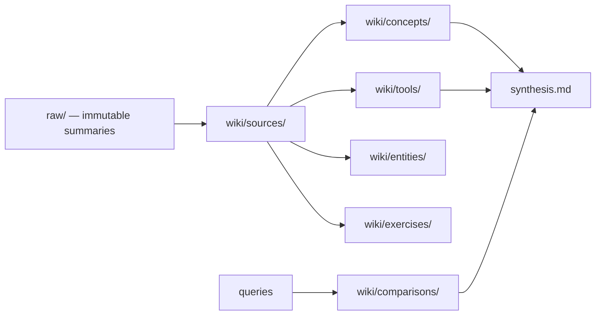
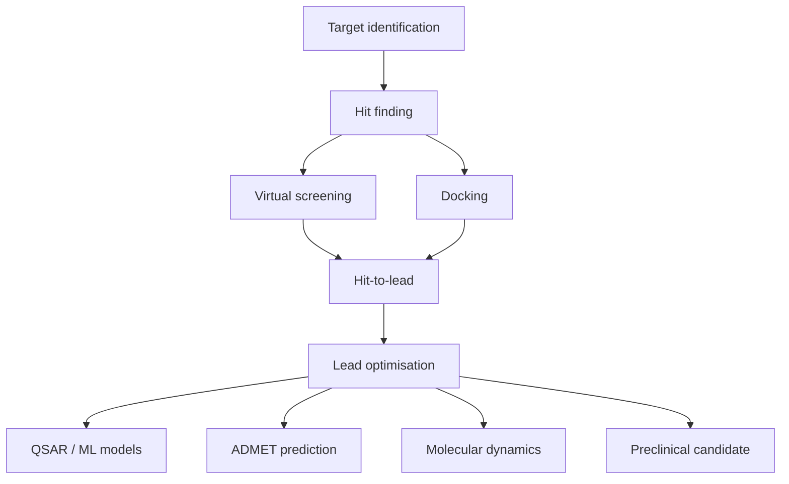
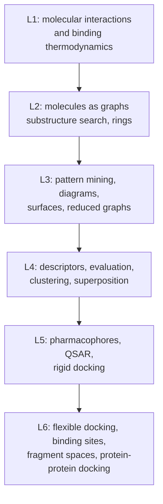

# Overview

A personal knowledge base on **cheminformatics and computational drug discovery**, built
incrementally from module summaries (lecture notes and exercise summaries). All pages are
written and maintained by the LLM according to `CLAUDE.md` in the repository root.

## How the wiki is organised

*Sources flow into topical pages; topical pages feed the synthesis; filed answers compound.*

## The domain, roughly

*The computational drug discovery pipeline; most concept pages attach to one of these stages.*

## Status

**All six CIW lecture scans and all four GCI foundation parts ingested** (`raw/ciw_1.pdf` ... `raw/ciw_6.pdf`, plus
`raw/foundation_gci_part1.pdf`, `raw/foundations_gci_part2.pdf` and
`raw/foundations_gci_part3.pdf`, `raw/foundations_gci_part4.pdf`). The wiki
currently holds 10 source pages, 145 concept pages and 9 exercise pages. See [[index]] for
the full catalog, [[log]] for the ingest history, [[synthesis]] for the running thesis and
[[open-questions]] for what is still unresolved.

The course arc, one lecture per step:

*Lecture 1 poses the physical question; lectures 2–4 build discrete proxies; lectures 5–6 apply them and then relax their assumptions one by one.*

Next operation: run a **lint pass** after the completed GCI series. The `tools/` and `entities/` sections now have first foundation entries, but many named software systems (FlexX, GLIDE, GOLD, AutoDock,
DOCK, CATALYST, CORINA, LUDI, MCSS, TOPAS, PatchDock, RosettaDock) that warrant their own
pages.
