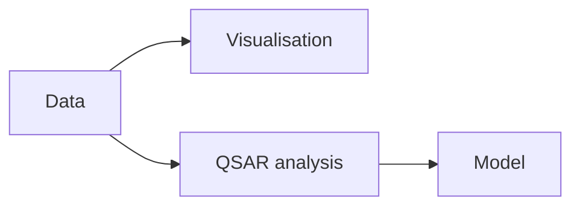

# AZOrange

AZOrange is an open-source workflow and modelling tool named in GCI for QSAR analysis.

## Why it matters

It represents the scripting/data-analysis side of workflow systems: data analysis, visualisation, programming and QSAR analysis.

## How it works

```text
PROCEDURE AZOrangeStyleQSAR(data)
  INPUT : molecular data table
  OUTPUT: QSAR model and visualisations

  inspect and visualise data
  choose descriptors and activity column
  train QSAR model
  evaluate model and export predictions
```


*AZOrange is positioned as an Orange/Python-style environment for QSAR workflows.*

## Practical notes

- The source gives only a short label; no node list or command syntax is provided.

## Limitations / caveats

- Treat this page as a stub until a source with concrete AZOrange usage is ingested.

## See also

- [[concepts/chemical-workflow-systems]]
- [[concepts/qsar]]

## Sources

- [[sources/gci-01-foundations-of-cheminformatics]] (p. 6)
