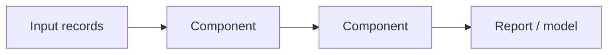

# Pipeline Pilot

Pipeline Pilot is a graphical scientific workflow system used to automate access, analysis and reporting of scientific data.

## Why it matters

GCI presents it as a reference workflow system for cheminformatics data processing.

## How it works

```text
PROCEDURE PipelinePilotStyleWorkflow(records)
  INPUT : molecular records
  OUTPUT: processed records or report

  for each component in workflow order:
      records <- component.process(records)
  return records
```


*Pipeline Pilot is represented as connected processing components.*

## Practical notes

- Example operations in the notes: input, normalisation, duplicate removal, filtering and activity handling.

## Limitations / caveats

- The source gives only a high-level description, not installation or component details.

## See also

- [[concepts/chemical-workflow-systems]]
- [[tools/knime]]

## Sources

- [[sources/gci-01-foundations-of-cheminformatics]] (p. 6)
